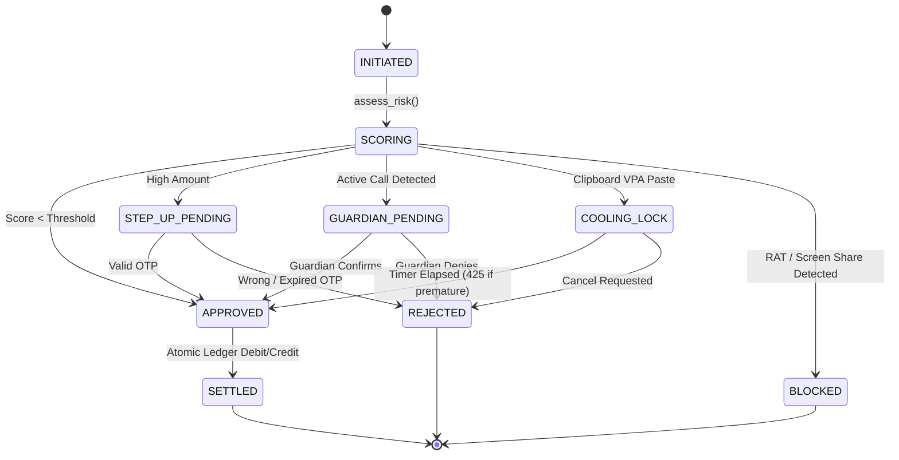

# ShieldPay Architecture & Reliability Specification

## 1. System Overview

ShieldPay is a real-time UPI fraud prevention platform. The **Payments Core & Reliability Engine (Person 1)** acts as the source of truth, managing:
1. Cryptographic request integrity and authentication.
2. Transaction lifecycle state machine enforcement.
3. Persistent idempotency deduplication with zero duplicate debits.
4. Atomic double-entry SQLite ledger settlement.
5. Real-time telemetry broadcast via Server-Sent Events (SSE).

```mermaid
flowchart TD
    Client["Client / Payer App"] -->|HMAC-SHA256 Signed POST| Core["ShieldPay Core (Rust / Axum)"]
    Core -->|1. Check Key| IdemStore[("Idempotency Store (SQLite)")]
    Core -->|2. Transition: INITIATED -> SCORING| Audit[("Audit Trail")]
    Core -->|3. Score Request (150ms)| RiskEngine["Risk Scoring Bridge (P2 / Local Fallback)"]
    RiskEngine -->|Decision & Score| Core
    Core -->|4. Transition Decision| StateMachine{"State Machine"}
    StateMachine -->|APPROVED| Ledger[("Double-Entry Ledger (ACID Transaction)")]
    Ledger -->|SETTLED| Core
    StateMachine -->|STEP_UP_PENDING| OtpMgr["Salted OTP Manager (120s TTL)"]
    StateMachine -->|COOLING_LOCK| CoolTimer["Cooling Timer (20s Demo)"]
    StateMachine -->|GUARDIAN_PENDING| GuardianHub["Guardian Approval Hub"]
    StateMachine -->|BLOCKED| Rejected["Terminal State"]
    Core -->|5. Broadcast: txn.updated| SSEStream["SSE Stream Hub (/api/stream)"]
```

---

## 2. Strict State Machine Specification

Any transition not explicitly declared below returns **HTTP 409 Conflict** and leaves the transaction state unchanged.



---

## 3. Atomic Double-Entry Ledger Settlement

Settlement enforces financial integrity guarantees:
* **ACID Transactions:** Debit on the sender account and credit on the receiver account occur in a single SQLite transaction.
* **Non-Negative Balances:** Sufficient funds check is performed inside the transaction lock.
* **Double Ledger Entries:** Both `DEBIT` and `CREDIT` rows are inserted into `ledger_entries` with updated balances.
* **Duplicate Prevention:** Existing ledger records for `txn_id` prevent duplicate debits on replay.

---

## 4. Cryptographic Security & Privacy Guarantees

1. **HMAC-SHA256 Body Integrity:**
   Every POST request is signed using HMAC-SHA256 over raw request bytes with secret `HMAC_SECRET`. Any byte tampering or unsigned request returns `401 Unauthorized`.
2. **Salted SHA-256 OTP Management:**
   Step-up OTPs are generated as 6-digit numeric codes. Only `SHA-256(16_byte_salt + otp)` is stored in memory with an expiration timestamp (`expires_at = now + 120s`). Single-use invalidation prevents replay.
3. **VPA Masking:**
   Virtual Payment Addresses are masked across all external interfaces (`rahul@okaxis` -> `rah***@okaxis`), protecting consumer privacy.
